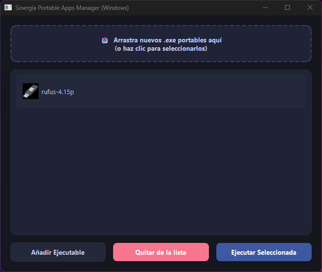

# Sinergia

## 📸 Captura de pantalla

Manager de archivos portables que permite organizarlos facilmente.

## 🚀 Características
- Interfaz gráfica moderna y fluida con PyQt6.
- Empaquetado optimizado para Windows.

## 📥 Descarga e Instalación
Puedes descargar la última versión estable del instalador directamente desde la sección de **[Releases](https://github.com/Nacho-Telmo/windows/releases)**.

1. Descarga `Sinergia_Installer.exe`.
2. Ejecuta el archivo y sigue las instrucciones del asistente de instalación.

## 🛠️ Tecnologías utilizadas
- **Python 3.12**
- **PyQt6**
- **Inno Setup** (para la creación del instalador)

## 📄 Licencia
Este proyecto está bajo la licencia **GNU General Public License v3.0 (GPLv3)**. Consulta el archivo [LICENSE](LICENSE) para más detalles.